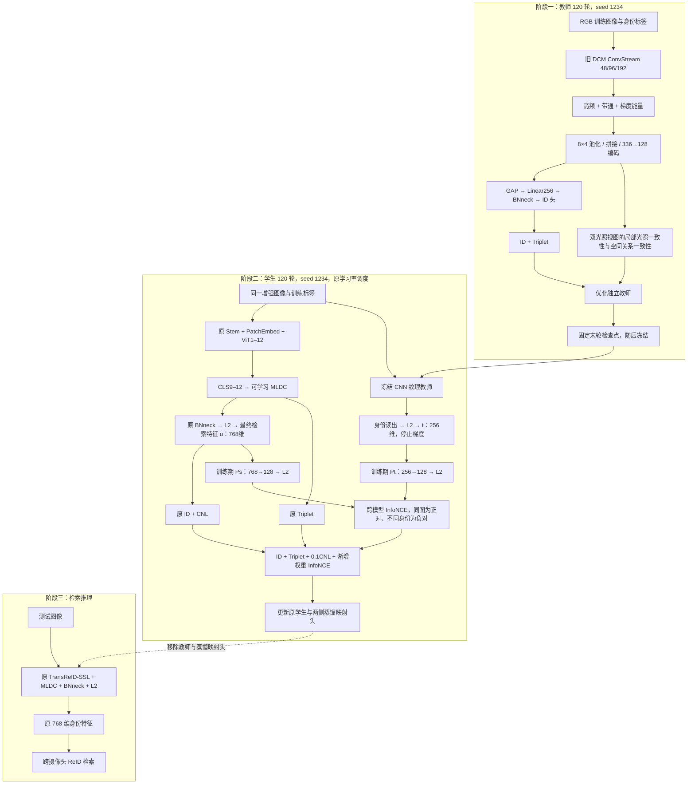

# 当前模块数据流：纹理教师 → 最终特征 InfoNCE

教师内部空间一致性只发生在独立 CNN；学生没有中间 Patch 蒸馏。教师网络冻结，两侧独立蒸馏映射头可学习。其他同身份图片不作 InfoNCE 负样本，原 CNL 提供跨相机约束。KD 权重为 `0.1 min(1,epoch/20)`，温度为 0.1。

10 轮先导教师很弱，120 轮教师和学生结果尚待训练。数据流表示实际执行路径，不代表已取得指标提升。
