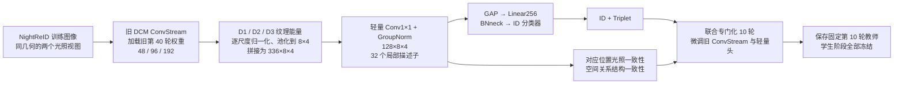
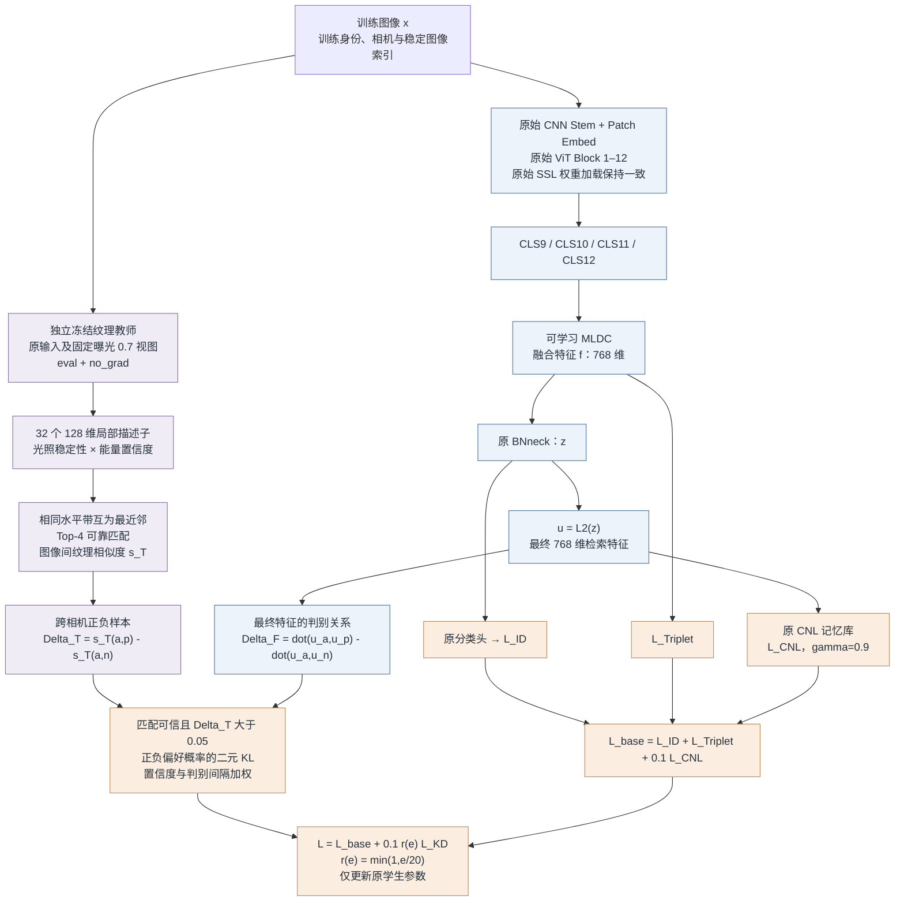
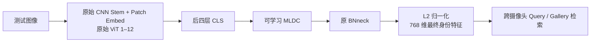

# 本轮数据流：独立 ConvStream 纹理教师 → 最终检索特征

实验包：`mldc_batchformerv2_cnl`。NightReID，seed=1234。默认主方案为 `configs/texture_relation_nightreid.yml`。下面描述待训练的完整模型结构；本轮仅完成代码与零更新验证。

## 一、离线教师专门化

旧 ConvStream 的三个 `Conv3×3,s2 + BN + ReLU` 块保持原类与参数键。RGB 输入为 `3×256×128`，输出分别为 `48×128×64`、`96×64×32`、`192×32×16`。仅加载旧 `detail_branch.convstream.*`；学生的原始 CNN Stem 与该教师不共享参数。

纹理能量为：

\[
E=(F-G_1(F))^2+(G_1(F)-G_2(F))^2+
  (S_x*G_1(F))^2+(S_y*G_1(F))^2,
\]
\[
B=\frac{\sqrt{\max(\operatorname{AvgPool}_{8\times4}(E),10^{-12})}}
 {\sqrt{\operatorname{Mean}_{HW}(F^2)+10^{-6}}}.
\]

`G1` 为 5×5、sigma1 的 Gaussian，`G2` 为 9×9、sigma2 的 Gaussian；Sobel 核作用于平滑特征，逐通道 reflect padding。Raw 对照使用 `AvgPool(F / RMS(F))`，其余结构和预算相同。

两个光照视图的空间几何相同。监督包括身份 CE + Triplet、对应位置局部向量的余弦一致性、去对角项的 Patch 余弦关系矩阵 MSE。ConvStream 权重可微调，旧 BN 运行统计量保留；全教师仅 413,872 个参数。

## 二、学生训练：最终特征判别关系蒸馏

教师匹配参数：网格 8×4、每水平带 2 行、两端 Patch 置信度至少 0.5、Top-4 且至少 2 对匹配。图像对的匹配置信度至少 0.25。正样本为跨相机同身份，负样本为跨相机不同身份；沿用原 PK batch，每 anchor 按学生相似度最多选 8 个困难负样本。相同图像索引不参与正负配对。

学生不读取中间 Patch 做蒸馏，也没有新增投影适配器。教师局部描述子只用于形成跨图像标量相似度，随后直接监督最终检索特征之间的关系。

### 损失的实际定义

\[
\Delta_T=s_T(a,p)-s_T(a,n),\qquad
\Delta_F=u_a^\top u_p-u_a^\top u_n.
\]

对满足匹配置信度要求、且 `Delta_T > m=0.05` 的三元组：

\[
q_T=\operatorname{sigmoid}(\Delta_T/\tau),\quad
q_F=\operatorname{sigmoid}(\Delta_F/\tau),\quad \tau=0.2,
\]
\[
w=\sqrt{c(a,p)c(a,n)}\,
\operatorname{clip}\left(\frac{\Delta_T-m}{1-m},0,1\right),
\]
\[
L_{KD}=\frac{\sum w\,D_{KL}(\operatorname{Bern}(q_T)\Vert\operatorname{Bern}(q_F))}{\sum w}.
\]

无可靠三元组时 KD 返回可微的零。教师分支和困难样本选择均停止梯度，KD 经 `u → BNneck → MLDC → 原 ViT` 回传。原有分类头仍由 ID 监督。

\[
L=L_{ID}+L_{Tri}+0.1L_{CNL}
  +0.1\min(1,e/20)L_{KD}.
\]

日志记录可靠三元组覆盖率及 KD 占原损失比例，以判断监督是否生效。置信度没有使用人体掩码，其对背景纹理的区分效果仍需实验评估。

## 三、最终推理

eval 时教师不执行；导出时移除 `texture_teacher.*`，权重可由原 MLDC 基线模型加载。推理不新增 CNN、适配器或描述子维度。

## 四、关键代码与验证状态

| 节点 | 对应文件 |
|---|---|
| 旧 48/96/192 ConvStream | `model/convstream.py`，保留原类 |
| 纹理 bank、轻量身份教师、光照一致性 | `model/texture_teacher.py` |
| 局部匹配、最终特征判别关系与二元 KL | `model/final_relation.py` |
| 原学生模型接入冻结教师 | `model/make_model_mldc.py` |
| 教师专门化入口 | `train_teacher.py` |
| 原损失与 KD、覆盖率日志 | `processor/processor_mldc.py` |
| 原模型兼容导出 | `export_inference.py` |

4 张真实训练图像、CPU、零优化器更新的代码检查通过。受控目标验证了最终检索路径梯度；未专门化的新纹理头在这 4 张图中的真实可靠三元组为 0，最大候选教师判别差约 0.02485。代码功能通过不能视为纹理蒸馏已经有效。教师专门化和学生完整训练均未执行。

[PNG 架构图](module_dataflow.png) · [矢量 PDF](module_dataflow.pdf) · [可编辑 draw.io](module_dataflow.drawio)

PNG/PDF 与 draw.io 使用同一组坐标和图元生成；本机没有 draw.io 命令行，未使用其原生导出。
