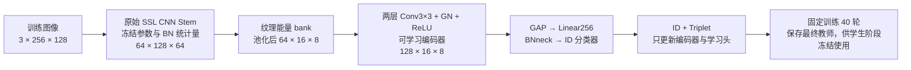
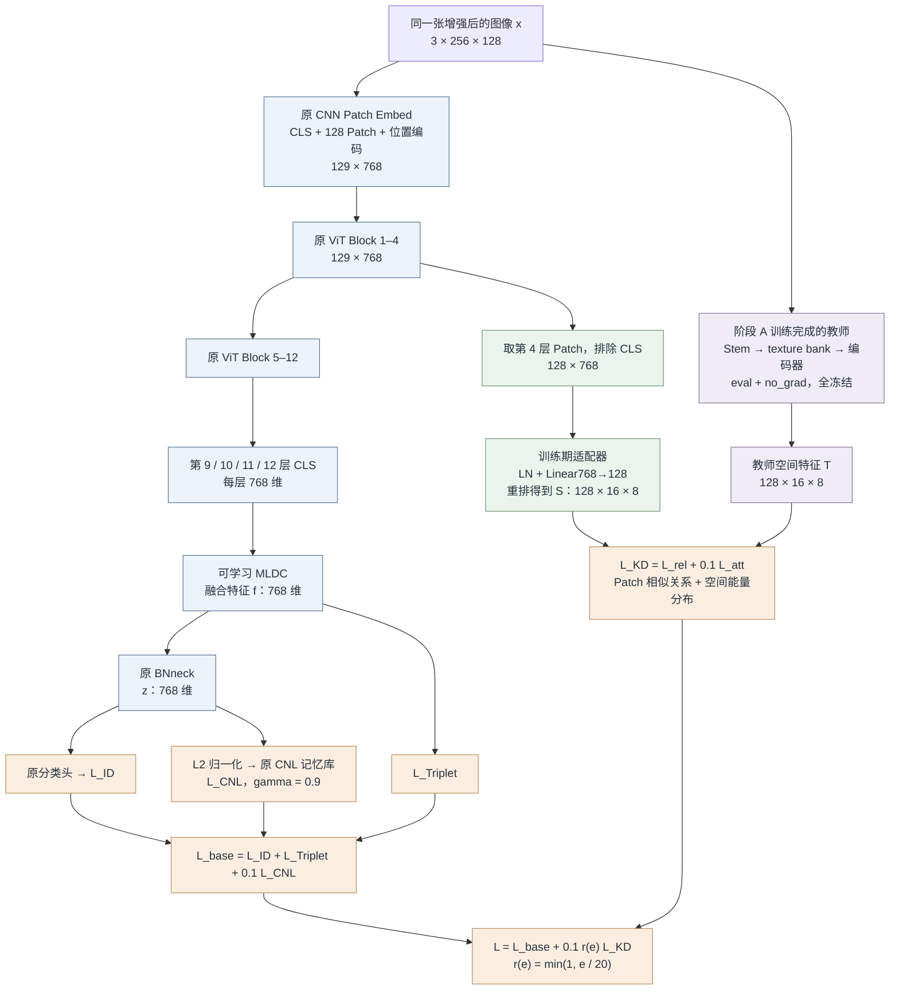

# 本轮模块数据流：mldc_texture_distill_cnl

对应代码主配置：`configs/texture_structure_nightreid.yml`。所有张量均省略 batch 维，随机种子固定为 1234。当前为代码验证阶段，教师与学生均未训练。

## 1. 离线纹理教师

教师 Stem 结构是 `Conv7×7,s2 → IBN → ReLU → Conv3×3 → IBN → ReLU → Conv3×3 → BN → ReLU`。输入尺寸 256 × 128，输出 64 × 128 × 64；Stem 从原始 TransReID-SSL 预训练权重初始化。

纹理 bank 先计算每通道的局部能量：

\[
G_1=\mathcal G_{5\times5,\sigma=1}(F),\quad
G_2=\mathcal G_{9\times9,\sigma=2}(F),
\]
\[
E=(F-G_1)^2+(G_1-G_2)^2+
  (S_x*G_1)^2+(S_y*G_1)^2,
\]
\[
B_{texture}=\sqrt{\max(\operatorname{AvgPool}_{16\times8}(E),10^{-12})}.
\]

`Sx / Sy` 为固定 Sobel 核，Gaussian / Sobel 使用逐通道卷积和 reflect padding。能量先池化再开方，保留每个通道，不在 bank 中压成一张单通道热力图。

`raw` 对照仅把 bank 替换为 `AvgPool16×8(F)`，其余教师网络、初始化、数据和预算相同。两种教师分别训练，学生运行时只使用其中一个。

## 2. 学生训练：主任务与纹理蒸馏

教师直接接收学生同一增强输入，空间位置一一对应。图中教师的 GAP、BNneck 和分类器用于阶段 A 学习身份；阶段 B 的蒸馏目标使用编码器输出的空间特征，教师全部冻结。

将学生和教师空间特征展开为 `S,T ∈ R^(128×128)`：第一维为 128 个空间 Patch，第二维为 128 个通道。对每个 Patch 沿通道做 L2 归一化，得到 `s_i,t_i`。

| 损失 | 实际计算 | 主方案权重 |
|---|---|---|
| `L_rel` | 学生、教师各自构建 128 × 128 的 Patch 余弦关系矩阵，去对角项后取 MSE | 1.0 |
| `L_att` | 每位置的通道均方能量归一化成 128 点概率分布，计算 KL(教师‖学生) | 0.1 |
| `L_feature` | 每 Patch 归一化通道向量直接取 MSE | 0；仅 feature 对照启用 |

`L_att` 的名字表示空间能量分布匹配，**不是**取 Transformer Attention 矩阵做监督。

完整损失为：

\[
L=L_{ID}+L_{Triplet}+0.1L_{CNL}
  +0.1\min(1,e/20)\left(L_{rel}+0.1L_{att}\right).
\]

梯度范围：主任务训练原有全部有效主干、MLDC、BNneck 和分类器；蒸馏项训练适配器及其之前的 Block1–4 和 Patch Embed。教师无梯度。适配器初始为随机映射，随学生共同学习；它只参与辅助损失计算。

## 3. 最终推理

`eval` 模式下教师与适配器不执行；`export_inference.py` 移除它们的权重，保留原 ViT + MLDC 的参数结构。纹理的作用来自学生训练时收到的梯度，推理时使用经过该监督训练的主干。

## 4. 对应代码位置

| 数据流节点 | 实现 |
|---|---|
| 冻结 SSL Stem、纹理 bank、身份教师 | `model/texture_teacher.py` 中 `TextureBank / TextureTeacher` |
| 第 4 层取 Patch、LN + Linear 适配 | `model/make_model_mldc.py` 中 `MLDCReID` |
| 关系、能量、直接特征损失 | `model/texture_teacher.py` 中 `distillation_terms` |
| 损失权重与 20 轮 ramp | `model/make_model_mldc.py` 中 `distillation_loss` |
| ID + Triplet + CNL + KD | `processor/processor_mldc.py` 中 `do_train` |
| 教师训练与固定第 40 轮权重 | `train_teacher.py` |
| 推理辅助权重移除 | `export_inference.py` |

附图：[PNG](module_dataflow.png)、[矢量 PDF](module_dataflow.pdf)、[可编辑 draw.io](module_dataflow.drawio)。PNG/PDF 与 draw.io 使用同一组图元坐标生成；本机没有 draw.io 命令行，PNG/PDF 为直接矢量绘制导出。
